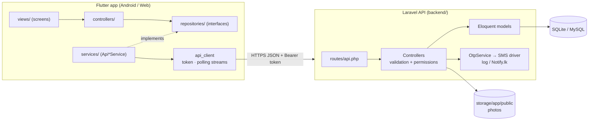
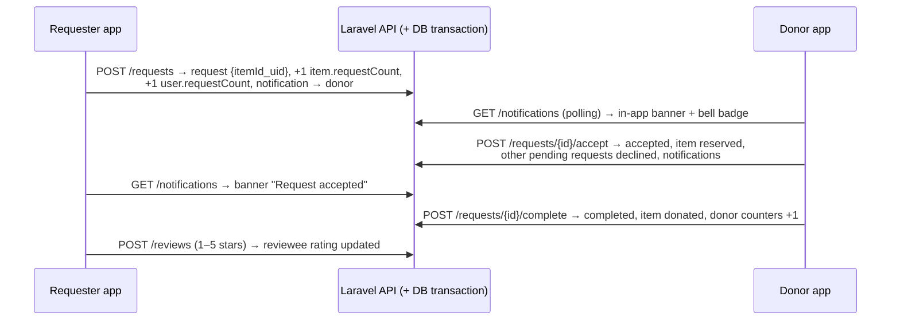

# Architecture & Deployment — Shareloop / EcoLanka

Owner: **Dulum (Infra)** · Backend: Laravel 12 REST API in `backend/`

## 1. Architecture diagram



## 2. How a request flows



## 3. Data

See `docs/SCHEMA.md`. Tables: `users`, `categories`, `items`, `needs`,
`share_requests`, `reviews`, `reports`, `notifications`, `otp_codes`,
`personal_access_tokens`.

Badges and eco points are computed in the app from `donationCount` /
`requestCount`. The average rating is stored on the user when a review is saved.

## 4. Layers (MVC + Dependency Inversion)

```
View (lib/views, widgets)  →  Controller (lib/controllers)  →  Repository interface
                                                                (lib/repositories)
                                                                       ▲ implements
                                                   API services (lib/services)
```

- Views never talk HTTP; they call `Dependencies.<controller>`.
- `lib/config/dependencies.dart` wires the API services into controllers once
  (`Dependencies.init(apiClient: …)` in `main.dart`). Tests pass fakes instead
  (`test/controller_test.dart`) or a mock HTTP client (`test/api_services_test.dart`).
- Live updates: `ApiClient.watch()` turns a GET endpoint into a `Stream` that
  polls every few seconds and refetches straight after any write, so screens
  keep using `StreamBuilder` as before.
- See `docs/DESIGN_PRINCIPLES.md` for SOLID / DRY mapping.

## 5. Repository layout

```
lib/
  config/        app_config (API URL), router, theme, constants, dependencies
  models/        user, user_role, item, need, request, handover_method, rating, badge,
                 report, app_notification
  controllers/   auth, user, item, need, request, review, report, notification (MVC "C")
  repositories/  abstract interfaces the controllers depend on (DIP)
  providers/     user_provider, language_provider
  services/      api_client + REST implementations of the repositories, geolocator
  utils/         helpers (categories, districts…), validators, formatters, json, api_exception
  views/         auth, common, home (shell, explore), items, requests, profile,
                 notifications, admin
  widgets/       item_card, request_card, rating_widget, user_badge, app_widgets
backend/         Laravel API (app/, routes/api.php, database/, tests/) — see backend/README.md
docs/            INFRA, SCHEMA, ARCHITECTURE, SECURITY_REPORT, QA_TEST_PLAN, GITHUB_SETUP
test/            Flutter unit tests
```

## 6. Deployment

### Prerequisites (one time)
- Flutter 3.47+ · PHP 8.2+ (with `pdo_sqlite`, `mbstring`, `openssl`, `fileinfo`) · Composer

### Backend
```bash
cd backend
composer install
cp .env.example .env && php artisan key:generate
php artisan migrate --seed
php artisan serve --host=0.0.0.0 --port=8000
```
Windows: `backend\start-backend.bat` does the same. Production: any PHP host
(e.g. a VPS with Nginx + PHP-FPM, Laravel Forge, Railway) with HTTPS and MySQL.

### Run / build the app
```bash
flutter pub get
flutter run -d chrome                                             # web → localhost:8000
flutter run                                                       # Android emulator → 10.0.2.2:8000
flutter run --dart-define=API_BASE_URL=http://192.168.1.20:8000/api   # real phone, same Wi-Fi
flutter build apk --release --dart-define=API_BASE_URL=https://api.example.lk/api
flutter build web --dart-define=API_BASE_URL=https://api.example.lk/api
```
